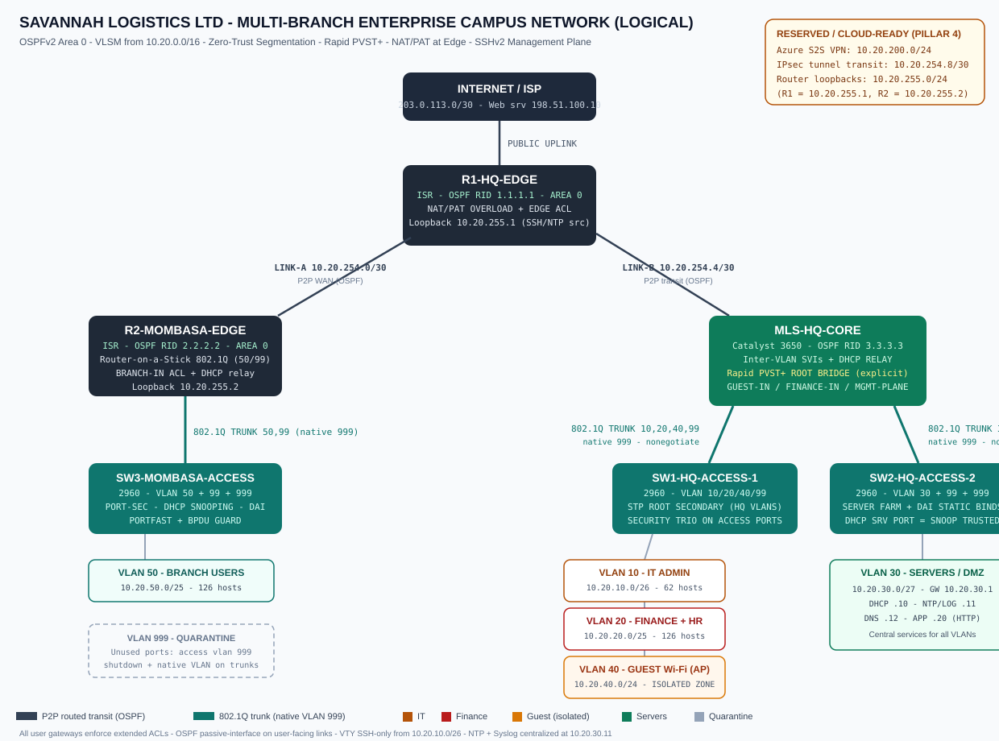

# Multi-Branch Enterprise Campus Network Design, Zero-Trust Segmentation & WAN Architecture


**Client:** Savannah Logistics Ltd. (Nairobi HQ + Mombasa Branch)
**Role:** Junior Network & Security Architect
**Aligned Certification:** Cisco CCNA 200-301 — The Complete Guide to Getting Certified (4 Courses)
**Project:** Architectural Blueprint #2

**Live design website:** <https://peterken-365.github.io/Multi-Branch-Enterprise-Campus-Network-Design-Zero-Trust-Segmentation-WAN-Architecture/>
(published via GitHub Pages from the `main` branch — see [Deployment](#8-deployment-github-pages))

---

## 1. Executive Summary

Savannah Logistics Ltd. has outgrown its single flat office router. The business now operates a
**Nairobi HQ** (50+ staff, internal servers, guest Wi-Fi) and a **Mombasa Regional Branch**
(20 staff) connected over a routed WAN. The legacy flat network concentrates every employee,
guest phone, and server into one broadcast domain (VLAN 1) with no redundancy, no encryption on
management sessions, no central time/logging, and no structured IP plan.

This repository is a complete, production-grade architectural package — not a tutorial dump. It
contains the **real Cisco IOS device configurations** (paste-ready for Packet Tracer 8.2+ or
physical Catalyst/ISR gear), the full **VLSM addressing architecture**, the **zero-trust ACL
policy matrix**, the **automation & cloud-readiness plan**, and a **7-test verification runbook**
with exact commands and expected outputs.

### Current architectural risks being eliminated

| # | Legacy Risk | Architectural Fix in This Design |
|---|-------------|----------------------------------|
| 1 | Single broadcast domain — one infected guest phone can scan Finance payroll servers | VLAN segmentation + extended ACL zero-trust policy at every gateway (Guest VLAN 40 is hard-isolated from all internal VLANs) |
| 2 | No deterministic redundancy — one switch link drops, the office goes dark | Rapid PVST+ with the HQ Multilayer Core switch explicitly designated Root Bridge; redundant uplinks; PortFast + BPDU Guard |
| 3 | Devices managed over Telnet/HTTP with no central time or logging | SSHv2-only VTY bound to management ACL, HTTP servers disabled, central NTP + Syslog to 10.20.30.11 |
| 4 | Oversized subnets, wasted IPs, no growth structure | Full VLSM plan from 10.20.0.0/16 sized to real demand, with reserved blocks for Azure hybrid expansion |

## 2. Logical Topology



- **R1-HQ-EDGE (ISR):** OSPF Area 0 edge router — NAT/PAT overload boundary, north-south edge ACL, default route to ISP.
- **R2-MOMBASA-EDGE (ISR):** Branch gateway — router-on-a-stick 802.1Q for VLAN 50/99, branch zero-trust ACL.
- **MLS-HQ-CORE (Catalyst 3650):** Inter-VLAN routing via SVIs, Rapid PVST+ Root Bridge, OSPF Area 0, DHCP relay agent.
- **SW1 / SW2 (HQ Access), SW3 (Branch Access):** VLAN access, trunks with hardened native VLAN, Port Security, DHCP Snooping, Dynamic ARP Inspection.

## 3. VLAN & VLSM IP Addressing Architecture

Allocated from the private block **10.20.0.0/16** using Variable Length Subnet Masking — every
segment is sized to realistic host demand, with headroom for structured growth.

| VLAN | Segment Name | Location | Subnet & Mask | Usable Hosts | Security Zone |
|------|--------------|----------|---------------|--------------|---------------|
| 10 | IT Admin & Helpdesk | Nairobi HQ | 10.20.10.0/26 | 62 | Privileged Admin Zone |
| 20 | Finance & HR | Nairobi HQ | 10.20.20.0/25 | 126 | High-Sensitivity Data Zone |
| 30 | Internal Servers / DMZ | Nairobi HQ | 10.20.30.0/27 | 30 | Controlled Application Zone |
| 40 | Guest & BYOD Wi-Fi | Nairobi HQ | 10.20.40.0/24 | 254 | Untrusted / Isolated Zone |
| 50 | Mombasa Operations | Branch | 10.20.50.0/25 | 126 | Standard Branch User Zone |
| 99 | Network Management | HQ + Branch | 10.20.99.0/27 (site-split /28s) | 30 | Out-of-Band / Infra Mgmt |
| 999 | Blackhole / Parking | All Switches | Unrouted | 0 | Unused Port Quarantine |
| Link A | HQ–Branch WAN (R1↔R2) | WAN | 10.20.254.0/30 | 2 | Point-to-Point Transit |
| Link B | Core-to-Edge Transit (MLS↔R1) | HQ | 10.20.254.4/30 | 2 | Point-to-Point Transit |
| — | Router loopbacks (R1/R2) | Global | 10.20.255.0/24 | /32s | Infrastructure Loopbacks |
| — | Azure S2S VPN reservation | R1 Edge | 10.20.200.0/24 | 254 | Cloud Extension (Project 5) |
| — | VPN tunnel transit | R1 Tunnel0 | 10.20.254.8/30 | 2 | IPsec S2S (reserved) |

**Design note (VLAN 99):** a Layer-2 VLAN cannot span the routed WAN, so the 10.20.99.0/27
management block is sub-allocated per site — `10.20.99.0/28` serves HQ switch SVIs (MLS .1,
SW1 .2, SW2 .3) and `10.20.99.16/28` serves the branch (R2 sub-interface .17, SW3 .18). Every
device stays inside the documented /27 management super-block while OSPF boundaries remain clean.

Full plan with gateways, DHCP scopes, server statics and exclusions:
[`01-topology-and-ip-plan/vlsm-ip-plan.md`](01-topology-and-ip-plan/vlsm-ip-plan.md)

## 4. The Four Architectural Pillars (mapped to the 4 CCNA courses)

| Pillar | Course | What is implemented in this repo |
|--------|--------|----------------------------------|
| 1 — IOS Essentials & Management-Plane Security | Foundations | SSHv2-only VTY, Telnet disabled, HTTP/HTTPS web mgmt disabled, VTY access-class restricted to VLAN 10, encrypted secrets, login block-for, legal banner, console protection, exec-timeouts |
| 2 — Switching, VLANs, Loop Prevention & Dynamic Routing | Intermediate | Rapid PVST+ with explicit Root Bridge, PortFast + BPDU Guard, hardened native VLAN 999 with `nonegotiate`, VLAN 1 eliminated, quarantine VLAN 999 for unused ports, OSPFv2 single Area 0 with passive-interface default |
| 3 — WAN, Services & Zero-Trust Micro-Segmentation | Advanced | Port Security, DHCP Snooping, Dynamic ARP Inspection; extended ACL matrix (Guest hard-isolation, Finance→Servers app-port-only, Branch→Finance deny, IT→Mgmt SSH-only); central DHCP + relay, NAT/PAT overload, NTP + Syslog architecture |
| 4 — Automation & Cloud-Readiness | Expert | Golden-config source-of-truth files, backup & drift-check scripts, Ansible inventory, SDN plane model + RESTCONF/JSON examples, reserved Azure S2S VPN blocks and IOS-XE IKEv2 tunnel template |

## 5. Zero-Trust Traffic Policy (condensed matrix)

| Source → Destination | Verdict |
|----------------------|---------|
| Guest (VLAN 40) → Internet | PERMIT — DNS, HTTP, HTTPS only |
| Guest (VLAN 40) → Any internal VLAN (10/20/30/50/99) | **DENY ALL** (logged) |
| Finance (VLAN 20) → Servers (VLAN 30) | PERMIT approved app ports only (80/443/1433) + DNS |
| Branch (VLAN 50) → Finance (VLAN 20) | **DENY** (logged) — branch reaches shared app servers in VLAN 30 only |
| Branch (VLAN 50) → Other internal VLANs | DENY (logged) |
| IT Admin (VLAN 10) → Management (VLAN 99) | PERMIT SSH / management only (VTY ACL double-enforcement) |
| Any → Perimeter (R1, inbound from ISP) | Only established TCP, DNS replies, ICMP replies/exceed/unreachable |

Full matrix with ACL-to-interface bindings:
[`03-network-security-policy/acl-traffic-matrix.md`](03-network-security-policy/acl-traffic-matrix.md)

## 6. Verification & Packet-Flow Testing Matrix

| Test ID | Scenario | Expected Architectural Result |
|---------|----------|-------------------------------|
| T-01 | Finance PC (VLAN 20) → HQ Server (VLAN 30) | Routes via Core MLS; ping/HTTP succeed |
| T-02 | Guest (VLAN 40) → Finance / Servers | Dropped immediately by extended ACL at gateway |
| T-03 | Guest (VLAN 40) → External Internet web | Succeeds via edge NAT/PAT overload |
| T-04 | Branch (VLAN 50) → HQ App Server (VLAN 30) | Routes dynamically across WAN via OSPF Area 0 |
| T-05 | Rogue device / rogue BPDU on access port | Port Security / BPDU Guard err-disables the port |
| T-06 | Unprivileged SSH from Guest VLAN 40 to gear | Rejected by gateway ACL + management VTY ACL |
| T-07 | VLAN 20 PC boots without static IP | Correct 10.20.20.x lease via central DHCP relay |

Runbook with exact commands and expected outputs:
[`05-verification-evidence/verification_report.md`](05-verification-evidence/verification_report.md)

## 7. Repository Structure

```
.
├── assets/                      # High-resolution topology diagram (SVG)
├── 01-topology-and-ip-plan/     # Topology, full VLSM plan (MD + CSV), PT build guide
├── 02-switching-and-routing-design/   # L2/STP design, OSPF design, 6 paste-ready .cfg files
├── 03-network-security-policy/  # ACL traffic matrix + Layer-2 security policy
├── 04-automation-and-cloud-readiness/ # Automation brief, SDN/REST model, Azure VPN reservation,
│                                      # backup/drift scripts, Ansible inventory, IKEv2 template
├── 05-verification-evidence/    # Verification runbook + screenshot checklist (T-01..T-07)
├── index.html … verification.html  # The live GitHub Pages design website (7 pages)
└── styles.css · script.js · favicon.svg · 404.html   # Website assets
```

## 8. Deployment (GitHub Pages)

The website is fully static and lives at the repository root (`index.html`, with `.nojekyll`
disabling Jekyll processing), so it can be published either way:

### Option A — Branch deployment (recommended, ~30-second one-time setup)

1. Open **Settings → Pages** in this repository.
2. Under **Build and deployment**, set **Source** to **Deploy from a branch**.
3. Choose **Branch: `main`** and **Folder: `/ (root)`**, then **Save**.
4. The site goes live at:
   <https://peterken-365.github.io/Multi-Branch-Enterprise-Campus-Network-Design-Zero-Trust-Segmentation-WAN-Architecture/>

Every push to `main` redeploys automatically — no build step is required for this static site.

### Option B — Actions deployment (optional)

If you prefer CI-based deployment, create `.github/workflows/deploy-pages.yml` with the content
below (GitHub web UI: **Add file → Create new file**, paste, commit), then set
**Settings → Pages → Source: GitHub Actions**. The workflow enables Pages itself
(`enablement: true`) and redeploys on every push to `main`.

```yaml
name: Deploy design website to GitHub Pages

on:
  push:
    branches: [main]
  workflow_dispatch:

permissions:
  contents: read
  pages: write
  id-token: write

concurrency:
  group: pages
  cancel-in-progress: false

jobs:
  build:
    runs-on: ubuntu-latest
    steps:
      - name: Checkout repository
        uses: actions/checkout@v4

      - name: Setup Pages (enables Pages on first run)
        uses: actions/configure-pages@v5
        with:
          enablement: true

      - name: Upload site artifact (repository root serves the website)
        uses: actions/upload-pages-artifact@v3
        with:
          path: .

  deploy:
    needs: build
    runs-on: ubuntu-latest
    environment:
      name: github-pages
      url: ${{ steps.deployment.outputs.page_url }}
    steps:
      - name: Deploy to GitHub Pages
        id: deployment
        uses: actions/deploy-pages@v4
```

## 9. Reproduce This Build

1. Follow [`01-topology-and-ip-plan/packet-tracer-build-guide.md`](01-topology-and-ip-plan/packet-tracer-build-guide.md) for device placement, cabling, and server services.
2. Paste the configs from [`02-switching-and-routing-design/configs/`](02-switching-and-routing-design/configs/) in build order (MLS → SW1/SW2/SW3 → R1 → R2).
3. Execute the 7 tests from the verification runbook and attach captures per the screenshot checklist.

The same `.cfg` files apply to real hardware (Catalyst 2960-X/9200 access, 3650/9300 core,
ISR 4331 edge) — comments inside each file flag the production-only hardening lines that
Packet Tracer does not support.

---

Prepared by **@peterken-365** — Junior Network & Security Architect (CCNA 200-301 track).
Credentials in the `.cfg` files are lab/design values and must be rotated before production use.
